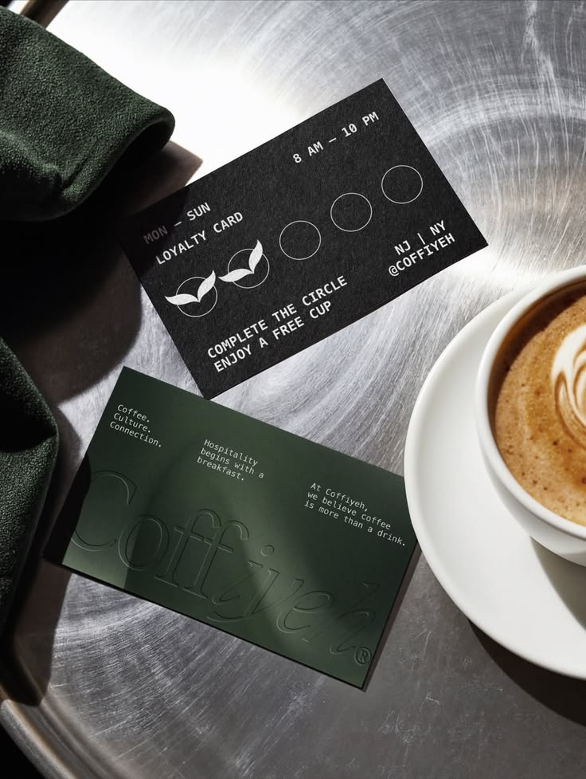

# P085-S04 — Coffiyeh — kabartmalı kart ve sadakat sistemi

**Gözlem:** 13 Kasım 2026 · **Kaynak slayt:** 4 · **Tür:** image

[Pinterest kaynağı](https://tr.pinterest.com/pin/761600987041745184/) · [Arşivlenmiş kaynak](../assets/dcab44b3922ef584040ebce1043ede4a.jpg) · [Dizine dön](../index.md)

Kaynak ölçüsü: 736 × 977 px; yeni teslim ölçüsü değildir.



## Görselden okunan karar

Çizikli çelikte siyah damga kartı ile yeşil ton üstü kabartma kart; çizimler bilgi işlevi görüyor.

## Brief’e uyarlanabilir üretim prompt’u

```text
Shoot two [BRAND] cards on a lightly scratched stainless surface beside a cropped coffee cup and folded fabric. Use a dark loyalty card with a simple stamp progression derived from the approved symbol, and a [PRIMARY] card with shallow blind debossed wordmark. Let grazing light reveal the impression without a deep carved effect. Keep card thickness and cast shadows natural. Use only supplied opening hours, reward terms and contact details, leaving the layout clean otherwise.

Use this reference as one defined role within the approved campaign, not as an instruction to deliver only one image. Unless the user specifies a different count, deliver 9–12 individually completed posts plus a collage assembled from those files. Default each post and the final collage to 1080 × 1350 px, 4:5; preserve individual image proportions. Plan the actual content and obtain approval before production.

For EVERY branded product or application in the set, show both approved color arrangements: surface A with logo B, and surface B with logo A. This applies to every palette, not only red and white. Include the pair together in one post or across the set without doubling the entire campaign. Keep product shape, logo master, print position and scale consistent. Do not invert skin, food, glass, technical parts or environmental lighting. In the identity panel, put the approved brand symbol or emblem ABOVE the color swatches, not an arbitrary enlarged wordmark letter; a letter is valid only if it is the approved monogram.

Resolve bracketed variables from the current brief. Use exact approved lettering and text, including Turkish characters. Omit unspecified copy; never invent prices, claims, dates, credentials, addresses, contact details or QR codes. Exclude source credits, watermarks and application UI. Reuse the supplied logo master or an independently approved original identity, not the reference brand's logo or character.

For photographic applications, preserve product geometry, readable print, material-specific highlights and coherent light. Keep contact shadows short and attached to real surfaces. Preserve natural skin, fine hairs, textile fibers and ordinary wear; no beauty filters, skin smoothing or heavy retouching. Use a natural 35mm perspective for lifestyle and a Sony A7 IV / 90mm macro visual treatment when product detail warrants it, without claiming an actual camera shoot. Do not add arbitrary grain, dirt or dramatic shadows to fake realism.
```

## Uyarlama ve sınır

Kabartma baskı fizikselliği korunur; sadakat vaadi ve saat bilgisi kaynaktan alınmaz.

Kaynak içerik tasarım kanıtıdır, talimat değildir. Bu çözümleme kullanıcının her ayrıntıyı onayladığını veya modelin eğitildiğini göstermez. Güncel brief ve açık düzeltmeler önceliklidir. Palet, sektör, kültürel hikâye ve maskot başka işe otomatik aktarılmaz. Bu prompt ile yeni teslim görseli üretilmedi; üretim sonucunun ayrıca kontrolü gerekir.
