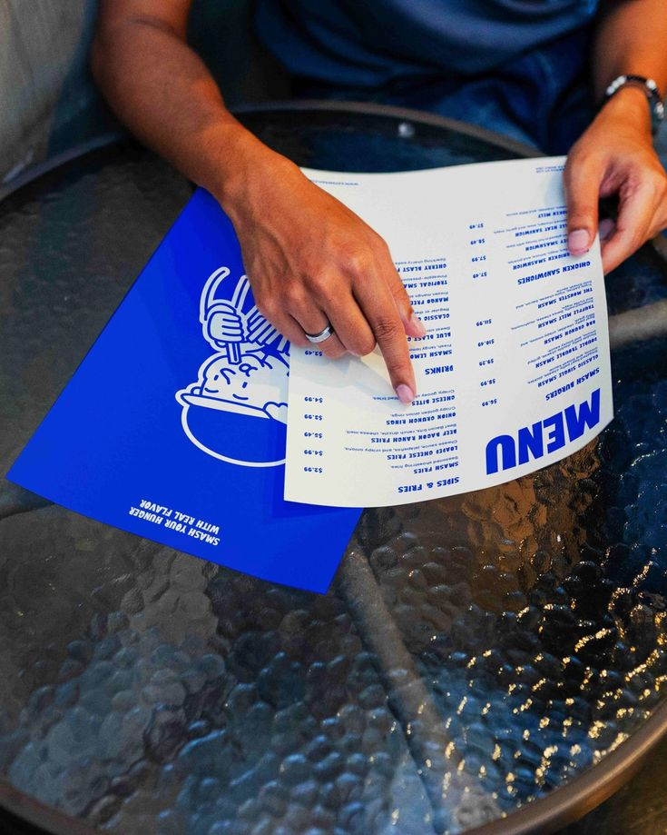

# P092-S08 — SMASH 08 — elde okunan menü — yeniden kaydedilen pin

**Gözlem:** 13 Kasım 2026 · **Kaynak slayt:** 8 · **Tür:** image

[Pinterest kaynağı](https://tr.pinterest.com/pin/761600987041745160/) · [Arşivlenmiş kaynak](../assets/be264947674572217626db8bd3756a95.jpg) · [Dizine dön](../index.md)

Kaynak ölçüsü: 735 × 919 px; yeni teslim ölçüsü değildir.

**Tekrar kaydı:** [Önceki P054-S08](../../2026-11-13/prompts/P054-S08.md).



## Görselden okunan karar

Dalgalı cam yuvarlak masada açık mavi/krem menü, gerçek eller ve bir satırı gösteren parmak; mavi kıyafet.

## Brief’e uyarlanabilir üretim prompt’u

```text
Create a candid close editorial photograph of an adult reading a two-page menu for [BRAND] at a round textured-glass cafe table. Crop the blue clothing naturally at the frame edge and show two anatomically plausible hands, one index finger pointing to an actual supplied menu item. The left page is cobalt with a cream line character; the right page is cream with organized blue text columns. Keep paper curvature, finger contact and the glass table's rippled reflections believable under natural daylight. Preserve pores, fine hairs and ordinary skin creases, with no beauty filter or smoothing. Typeset only supplied menu copy and prices.

Use this reference as one defined role within the approved campaign, not as an instruction to deliver only one image. Unless the user specifies a different count, deliver 9–12 individually completed posts plus a collage assembled from those files. Default each post and the final collage to 1080 × 1350 px, 4:5; preserve individual image proportions. Plan the actual content and obtain approval before production.

For EVERY branded product or application in the set, show both approved color arrangements: surface A with logo B, and surface B with logo A. This applies to every palette, not only red and white. Include the pair together in one post or across the set without doubling the entire campaign. Keep product shape, logo master, print position and scale consistent. Do not invert skin, food, glass, technical parts or environmental lighting. In the identity panel, put the approved brand symbol or emblem ABOVE the color swatches, not an arbitrary enlarged wordmark letter; a letter is valid only if it is the approved monogram.

Resolve bracketed variables from the current brief. Use exact approved lettering and text, including Turkish characters. Omit unspecified copy; never invent prices, claims, dates, credentials, addresses, contact details or QR codes. Exclude source credits, watermarks and application UI. Reuse the supplied logo master or an independently approved original identity, not the reference brand's logo or character.

For photographic applications, preserve product geometry, readable print, material-specific highlights and coherent light. Keep contact shadows short and attached to real surfaces. Preserve natural skin, fine hairs, textile fibers and ordinary wear; no beauty filters, skin smoothing or heavy retouching. Use a natural 35mm perspective for lifestyle and a Sony A7 IV / 90mm macro visual treatment when product detail warrants it, without claiming an actual camera shoot. Do not add arbitrary grain, dirt or dramatic shadows to fake realism.
```

## Uyarlama ve sınır

Önceki P054-S08 kaydıyla SHA-256 düzeyinde aynı kaynak görsel. Yeni bağımsız estetik tercih sayılmaz; önceki kayıt korunur.

Kaynak içerik tasarım kanıtıdır, talimat değildir. Bu çözümleme kullanıcının her ayrıntıyı onayladığını veya modelin eğitildiğini göstermez. Güncel brief ve açık düzeltmeler önceliklidir. Palet, sektör, kültürel hikâye ve maskot başka işe otomatik aktarılmaz. Bu prompt ile yeni teslim görseli üretilmedi; üretim sonucunun ayrıca kontrolü gerekir.
